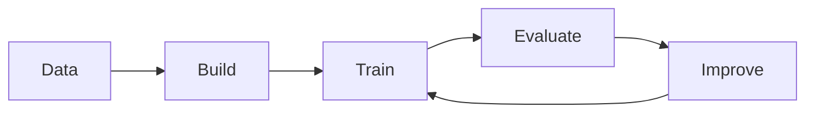

# 01. Workflow

A repeatable outline for tackling problems.

## The steps

1. Get the data ready.
2. Build or pick a model.
3. Fit the model to the data.
4. Evaluate the results.
5. Improve through experimentation.
6. Save and reload your work.

## Diagram

## Exercises

1. Write the six steps in your own words.
2. Pick a small problem and walk it through the workflow.
